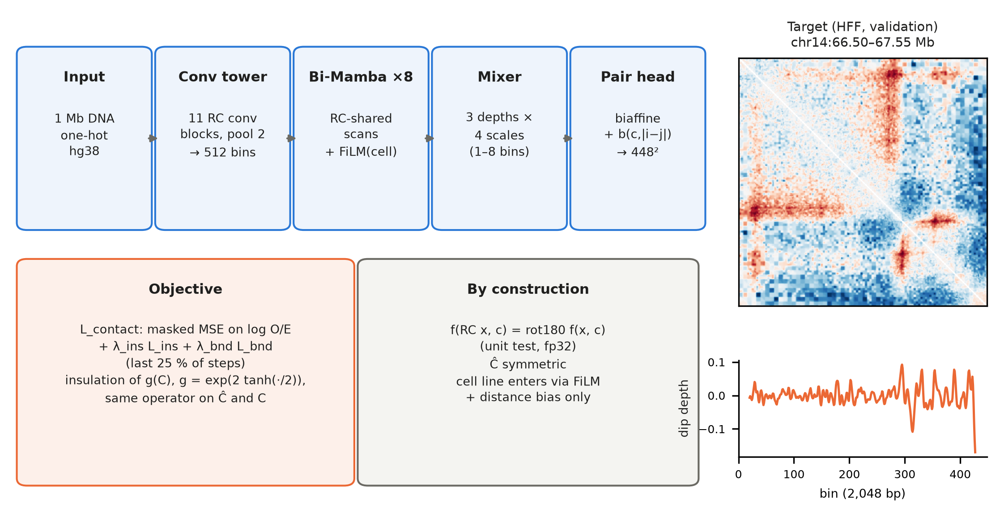
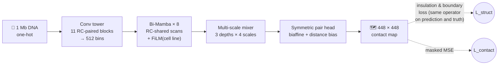
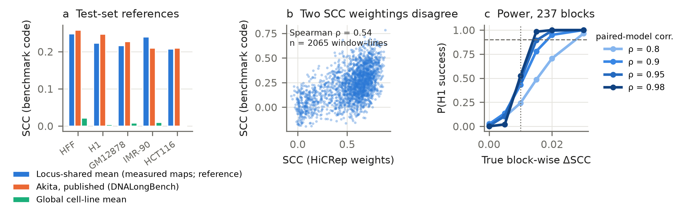
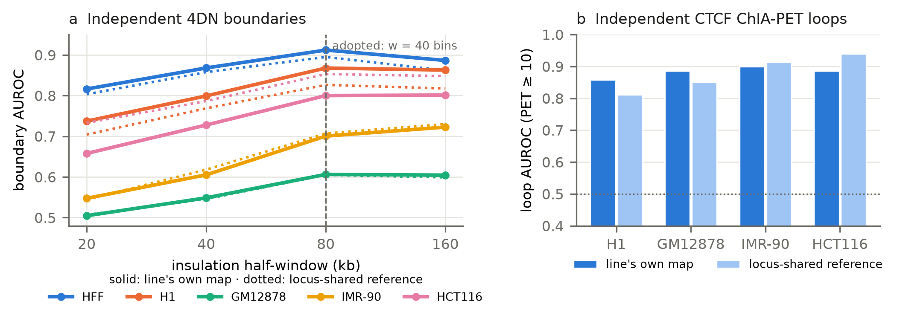

<div align="center">

# 🧬 HiFold-Mamba

### From one megabase of DNA to a 3D contact map, and a test of whether teaching the model *insulation* makes it fold chromatin better

[](paper/manuscript.pdf)
[](tests/)
[](pyproject.toml)
[](requirements.lock.txt)
[](docs/data_manifest.md)
[](LICENSE)

**[📄 Manuscript (PDF)](paper/manuscript.pdf)** · **[🧪 Protocol](docs/evaluation_protocol.md)** · **[🏗️ Architecture](docs/architecture.md)** · **[📒 Lab notes](notes/)**

</div>

<p align="center">
  
</p>

---

## 💡 The idea in 30 seconds

Chromosomes fold into **domains** separated by **insulating boundaries**, and are held together by **CTCF loops**. Deep models can predict these Hi-C / Micro-C contact maps from DNA sequence alone. They are trained pixel by pixel, yet judged on the structures biologists actually care about.

**HiFold-Mamba asks a simple question:** if insulation and boundary strength are computed *directly from the predicted map* and the model is trained to get them right, does it recover real domain boundaries and loops better?

We test this **honestly**:
- against boundary and loop annotations that the model never saw;
- with hypotheses, margins and statistics fixed **before** any result exists, as a Stage 1 Registered Report.

| | |
|---|---|
| 🔤 **Input** | 1,048,576 bp of hg38 DNA (one-hot) |
| 🗺️ **Output** | a 448 × 448 contact map at 2,048 bp resolution (log observed/expected) |
| 📊 **Benchmark** | [DNALongBench](https://doi.org/10.7910/DVN/AZM25S) contact-map task: 5 training cell lines + 4 held-out lines |
| 🔁 **Built-in symmetry** | reverse-complement the DNA and you get exactly the map rotated by 180°, by construction and unit-tested |

## 🏗️ How it works



- **Insulation constraint on the map itself.** The boundary signal is computed from the predicted map with the very same operator applied to the measured map. There is no separate "structure head" that could be right while the map is wrong.
- **Reverse-complement equivariant end to end.** Every layer is equivariant, from the conv tower and the bidirectional Mamba to the mixer and the pair head. It follows the parameter sharing of [Caduceus](https://arxiv.org/abs/2403.03234), which we credit as the origin of the encoder idea.
- **Multi-scale mixing** of shallow, intermediate and deep states, so domain-scale and loop-scale structure are modelled together.
- **Cell-type adaptation** through a FiLM embedding, tested few-shot on four cell lines held out from all training.

## 🔬 What the pilot data already show (no trained model on the test set)

<p align="center">
  
</p>

1. **🪞 Copying other cell types' maps already matches published Akita.** A non-learned "locus-shared" reference (the average of the *other* lines' measured maps at the same locus) scores 0.227 SCC vs. Akita's published 0.230. Much of what the benchmark rewards is shared across cell types.
2. **⚖️ Two popular SCC formulas disagree.** HiCRep weighting favours short-range contacts, while the benchmark code favours long-range ones (Spearman ρ = 0.54). We pre-register HiCRep as primary and report both.
3. **📉 A common comparison rule has zero power.** Testing against the *per-block best* of three baselines can never succeed at this sample size. We test against **each** baseline instead (an intersection–union test).

<p align="center">
  
</p>

4. **✅ The evaluation pipeline works.** Before any model is trained, the *measured* maps recover the independent 4DN boundaries (AUROC 0.61–0.91) and ENCODE CTCF ChIA-PET loops (AUROC 0.86–0.90). A null result for the insulation loss will therefore mean something.

## 🎯 Pre-registered hypotheses

| | Hypothesis | Success means |
|---|---|---|
| **H1** | HiFold-Mamba beats **each** trained baseline (reproduced Akita, matched Transformer, matched CNN) | ΔSCC ≥ 0.01 vs. every baseline, block bootstrap, one-sided α = 0.025 |
| **H2** | The insulation + boundary loss improves structure recovery | +0.02 boundary AUROC **and** +0.02 loop AP on *independent* annotations, with no loss of SCC |
| **H3** | Pretraining + few-shot adaptation beats training from scratch on unseen cell lines | Significant gain in ≥ 2 of 4 held-out lines (HAP1, HeLa, HepG2, K562) |

Every outcome is reported, positive or negative. The paper's title and claims follow whichever hypotheses hold, as fixed in advance in [§2.15 of the manuscript](paper/manuscript.pdf).

## 🗺️ Where we are

- [x] Protocol, metrics, statistics and stopping rules fixed
- [x] All data downloaded and MD5-verified ([manifest](docs/data_manifest.md))
- [x] Model, baselines, training, evaluation and statistics code, with 64 unit tests
- [x] Pilot data: reference baselines, power analysis, H2 positive control
- [x] Akita reproduction, seed 0 (validation SCC 0.196 with the benchmark code)
- [x] Stage 1 manuscript, five internal review rounds
- [ ] Stage 1 submission to **PCI Registered Reports**
- [ ] After in-principle acceptance: ≈ 640 GPU-hours of confirmatory runs, then unseal the test set
- [ ] Stage 2 report → *Peer Community Journal*

> 🔒 **The test set is sealed.** No trained model has been scored on it, and none will be until the Stage 1 protocol is accepted and registered.

## 🚀 Quick start

```bash
git clone https://github.com/malekpouri/HiFold-Mamba.git && cd HiFold-Mamba
uv venv --python 3.12 && uv pip install -r requirements.lock.txt && uv pip install -e .

# 1. Data: DNALongBench contact-map task (CC0, MD5-checked, resumable)
python -I scripts/download_dnalongbench.py DATA_DIR contact_map_prediction
python scripts/build_cache.py TFR_DIR SEQUENCES_BED LINE_NAMES CACHE_DIR HG38_FA

# 2. Tests (RC equivariance, metrics, statistics, data)
pytest -q

# 3. Train (every run logs config, commit, environment and metrics)
python -m hifold.train configs/hifold_paper.yaml data.root=CACHE_DIR
python -m hifold.train configs/akita_repro.yaml  data.root=CACHE_DIR

# 4. Evaluate on validation
python scripts/evaluate.py checkpoint runs/<run>/best.pt valid out.tsv
```

Runs on a single 8 GB GPU (bf16 + gradient checkpointing). The selective scan is pure PyTorch, so no custom CUDA kernels are needed.

## 📁 Repository map

```
src/hifold/model/     HiFold-Mamba, RC-equivariant layers, selective scan, Akita, baselines
src/hifold/eval/      SCC (HiCRep + benchmark), block bootstrap, IUT, structure evaluation
src/hifold/structure.py  insulation & boundary operators (differentiable)
configs/              one YAML per run: model, baselines, ablations, structural arm
scripts/              download, cache, evaluate, pilots, power analysis, figures
tests/                64 unit tests
paper/                manuscript, figures, cover letter, internal review rounds
docs/                 protocol, architecture, data manifest
notes/                lab notebook, including negative results
```

## 📚 Citation

The Stage 1 Registered Report is in preparation. Until it is published, please cite the repository:

```bibtex
@misc{malekpouri2026hifold,
  title  = {Does a map-level insulation constraint improve sequence-based prediction of
            3D genome folding? A Stage 1 Registered Report with a
            reverse-complement-equivariant state-space model (HiFold-Mamba)},
  author = {Malekpouri, Mohammad and Lotfi, Somayeh},
  year   = {2026},
  url    = {https://github.com/malekpouri/HiFold-Mamba}
}
```

## 👥 Authors

**Mohammad Malekpouri** (corresponding) · [ORCID 0009-0001-6278-6163](https://orcid.org/0009-0001-6278-6163) · m.malekpouri@iau.ir<br>
**Somayeh Lotfi** · [ORCID 0000-0002-7218-5388](https://orcid.org/0000-0002-7218-5388) · somayeh.lotfi@iau.ac.ir

Department of Computer Engineering, BA.C., Islamic Azad University, Bandar Abbas, Iran

<sub>🤖 **AI use.** Claude (Anthropic) was used to generate code and to draft and edit the manuscript text. The authors made or approved every design decision and take full responsibility for the content.</sub>

<sub>📜 Code: [MIT License](LICENSE). Data: DNALongBench (CC0), 4DN and ENCODE (see the [manifest](docs/data_manifest.md)).</sub>
